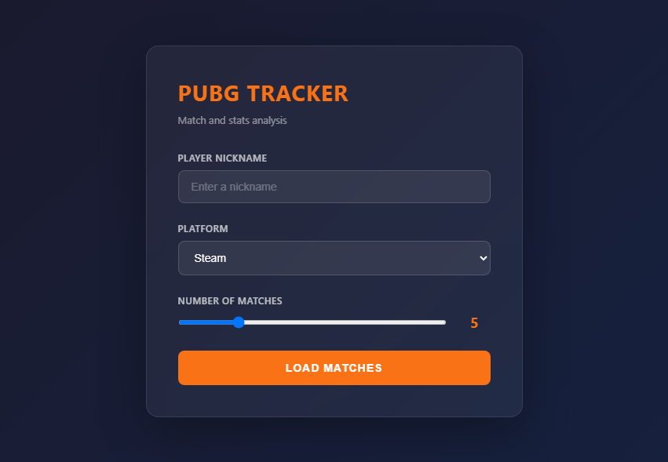

# PUBG Tracker


[](LICENSE)

**[▶ Try the live demo](https://zerodaylight0.github.io/PUBG-tracker/)** — no install needed. Open the demo
matches, or paste your own PUBG API key to analyze real matches right in the browser.

[](https://zerodaylight0.github.io/PUBG-tracker/)


Local PUBG match analyzer built around an interactive tactical map. Search a
player, load recent matches, select a squad member and review movement,
combat events and key statistics in one focused interface.

Built with Python, the official PUBG API and a lightweight browser UI. The
API key stays on the local machine and is never sent to the browser.

## Features

- Search a player by nickname and platform.
- Load the latest 1–20 matches.
- Review placement, kills, knocks (DBNOs), assists, damage, headshots, longest
  kill, revives and distance for the squad.
- Render movement, parachute drop, kills, knockdowns, deaths, revives, zones
  and the plane path from telemetry.
- Readable weapon names (`WeapHK416_C` → `M416`) from the official
  [pubg/api-assets](https://github.com/pubg/api-assets) dictionaries.
- Combat log with match time, headshots and team kills; click an entry to
  jump to it on the map.
- Pan, zoom and inspect events directly on the tactical map.
- **Heatmap overlay** (off by default): landing spots, kills, knocks dealt,
  deaths, knocks taken and movement density of the selected player, for the
  current match or aggregated over **all stored matches on the same map**.
- **Local match database** (SQLite): every match and its telemetry is saved,
  so the history keeps growing past the ~20 matches / 14 days the PUBG API
  returns. Browse it with filters by player, map and mode.
- Switch between match history and squad members without leaving the map.
- Cache map assets locally after the first request; never download a stored
  match or its telemetry twice.
- Keep the PUBG API key outside source control.

## Live demo

The [live demo](https://zerodaylight0.github.io/PUBG-tracker/) is the same interface hosted on
GitHub Pages, without the Python server:

- **Demo matches** work without a key. They are generated by
  `tools/make_demo.py` in the exact format of the PUBG API and telemetry.
- **Your matches**: enter your PUBG API key, nickname and platform. The browser
  calls `api.pubg.com` directly; the key is kept only in this browser
  (session storage, or local storage if you tick "Remember").

The site is deployed by `.github/workflows/pages.yml` on every push to
`main`, after the tests pass. In the repository settings, Pages must use
**GitHub Actions** as the source.

## Heatmap

Tick **HEATMAP** in the right panel. A card appears in the top-right corner of
the map:

- **Layers**: Landing, Kills, Knocks dealt, Deaths, Knocked, Movement. Each
  layer is normalized on its own, so a few kills are not drowned out by
  hundreds of movement samples.
- **Scope**: *This match*, or *All stored matches on this map* (local app,
  read from the database) / *All loaded matches on this map* (browser mode
  and demo, built from the matches of the current session).
- The status line shows how many matches and points are on the map, and how
  many matches are still waiting for their telemetry download.

The overlay is drawn on the map canvas (blue → green → yellow → red for
low → high density) without any extra library or CDN, so it also works in the
GitHub Pages demo. In a screenshot of an Erangel squad history the map shows
red hot spots on the usual drop towns, a warm trail along the rotations to
the circle and isolated spots where fights happened.

The heatmap follows the selected squad member: click a teammate to see their
landings and fights.

## Match database

When the tracker runs on your PC or server (`app.py`, `start.bat`,
`start.sh`), it creates a SQLite database on first start. No database server
or extra package is needed (Python's built-in `sqlite3`).

- **Location**: `storage/pubg-tracker.sqlite3` next to `app.py`. Change it
  with `--data-dir PATH` or the `PUBG_TRACKER_DATA_DIR` environment variable.
  The folder is ignored by Git.
- **What is stored**: every match a search loads (all participants and their
  stats) and its telemetry, reduced to the events the UI needs and
  gzip-compressed (typically 1–2 MB per match).
- **How history accumulates**: the PUBG API only keeps matches for about
  **14 days** and returns a player's latest matches. Each search adds the new
  ones to the database; matches already stored are read from disk instead of
  the API, and their telemetry is never downloaded again. Search a player
  regularly (for example every week) and their history grows to hundreds of
  matches. Repeated searches never create duplicates (the match id is the
  primary key and stats are unique per match and player).
- **Telemetry** of new matches is downloaded in the background right after a
  search, so heatmaps over old matches keep working after the CDN copy is
  gone.
- **Browsing**: the *Stored* tab of the match history lists stored matches
  with pagination and filters by player, map and mode. The start page offers
  *Browse stored matches* without a new search.
- **Schema migrations**: the schema version is kept in `PRAGMA user_version`
  and upgraded automatically on start. Back up the `storage/` folder to keep
  your history.

## Screenshots

| View | Preview |
|---|---|
| Start screen |  |
| Tactical map |  |

## Requirements

- Python 3.10+
- A PUBG Developer API key
- Internet access for API, telemetry and first-time map downloads

## Get a PUBG API key

1. Open the [official PUBG Developer Portal](https://developer.pubg.com/).
2. Sign in with your PUBG developer account.
3. Create an application and copy its API key.
4. Keep the key private and configure it through the environment variable
   shown below.

The API has rate limits. Use the application responsibly and follow the
current PUBG API terms and documentation.

## Installation and configuration

Install dependencies:

```powershell
python -m pip install -r requirements.txt
```

Configure the key only in the process environment (or a local `.env` file
with `PUBG_API_KEY=...`, which is ignored by Git):

```powershell
$env:PUBG_API_KEY = "YOUR_PUBG_API_KEY"
python app.py
```

```bash
export PUBG_API_KEY="YOUR_PUBG_API_KEY"
./start.sh
```

Open [`http://localhost:8000/start`](http://localhost:8000/start) in your
browser. `start.bat` (Windows) and `start.sh` (Linux/macOS) launch the
application from their own directory and install `requests` on first run if
it is missing (`start.sh` uses a local `.venv`).

Options (command line or environment):

| Option | Environment | Default |
|---|---|---|
| `--port` | `PORT` | `8000` |
| `--host` | `PUBG_TRACKER_HOST` | `127.0.0.1` (this computer only) |
| `--data-dir` | `PUBG_TRACKER_DATA_DIR` | `./storage` |
| `--no-browser` | `PUBG_TRACKER_NO_BROWSER=1` | opens a browser |
| | `PUBG_TRACKER_ALLOWED_HOSTS` | `localhost,127.0.0.1,::1` |

On a server, run for example `./start.sh --host 0.0.0.0 --no-browser` and set
`PUBG_TRACKER_ALLOWED_HOSTS=tracker.example.lan`. The tracker has no login:
keep it on a trusted network or behind a reverse proxy with authentication.

## Usage

1. Enter a PUBG nickname.
2. Select Steam, Kakao, PlayStation, Xbox or Stadia.
3. Choose the number of recent matches.
4. Select a match in the history panel (*Search* tab), or browse older ones in
   the *Stored* tab.
5. Select a squad member to draw their route and events on the map.
6. Use the right panel for the combat log and compact player statistics.
7. Turn on **HEATMAP** and pick layers and scope.

## Project structure

```text
PUBG-tracker/
├── app.py                 # Local API proxy, telemetry loader, HTTP endpoints
├── db.py                  # SQLite match database and migrations
├── heatmap.py             # Heatmap points from telemetry (server side)
├── heatmap.js             # Heatmap points, density grid and colors (browser)
├── index.html             # Tactical map interface
├── tailwind.css           # Built styles, served locally (source: styles/)
├── start.html             # Search screen
├── telemetry.js           # Telemetry parser (kills, knocks, deaths, zones)
├── pubg-data.js           # Data sources: local server, browser (API key), demo
├── demo/                  # Sample matches for the live demo
├── tools/make_demo.py     # Generates demo/
├── data/                  # Weapon and damage-type name dictionaries
├── tests/                 # Python and Node tests
├── start.bat              # Windows launcher
├── start.sh               # Linux/macOS launcher
├── requirements.txt       # Python dependencies
├── requirements-dev.txt   # Test dependencies (pytest)
├── package.json           # Tailwind CLI, only needed to rebuild tailwind.css
├── docs/images/          # Project screenshots
├── storage/               # Match database, ignored by Git
├── maps/                  # Runtime cache, ignored by Git
└── vers/                  # Local development archives, ignored by Git
```

## Tests

```bash
python -m pip install -r requirements.txt -r requirements-dev.txt
python -m pytest tests
node --test tests/
```

CI (`.github/workflows/ci.yml`) runs both suites on Ubuntu and Windows for
every pull request.

### Styles

`tailwind.css` is committed, so running the app needs neither Node.js nor a
CDN. After changing Tailwind classes in `index.html` or the scripts, rebuild it:

```bash
npm ci
npm run build:css
```

CI fails if the committed file is out of date.

## Architecture

```text
Browser → Local Python proxy :8000
                       ├── SQLite (storage/): matches, stats, telemetry, heatmap cache
                       ├── PUBG API: player lookup and new matches only
                       ├── PUBG telemetry CDN: once per match
                       └── PUBG map assets: local cache in maps/
```

The browser never receives the API key. The local Python process makes
authenticated requests to the PUBG API.

## Security

- `PUBG_API_KEY` is read from the environment or a local ignored `.env` file.
- Never commit `.env` files, API keys, tokens or personal data.
- Large downloaded maps, old ZIP archives and the match database are
  intentionally ignored.
- The server listens on `127.0.0.1` by default, rejects unknown `Host`
  headers (DNS rebinding) and cross-site POSTs, only downloads telemetry from
  `telemetry-cdn.pubg.com`, and uses parameterized SQL only.
- Tailwind is built into `tailwind.css` and served locally instead of running
  a script from a CDN; Font Awesome is pinned with Subresource Integrity.
- Revoke and replace a key immediately if it was ever exposed.

## Known limitations

- Data depends on PUBG API availability and rate limits (429 responses are
  retried after the `Retry-After` delay).
- The PUBG API keeps matches for about 14 days: anything older exists only in
  your local database.
- Map assets can be large and are downloaded on first use: a light preview is
  shown immediately and the high-resolution map (~100 MB) replaces it once
  it has been downloaded and cached in `maps/`.
- The server has no user accounts; it is meant for your own PC or a trusted
  network, not public hosting.
- The browser-only mode (GitHub Pages) has no database: its heatmap covers
  the matches loaded in the current session.

## License

This project is distributed under the [MIT License](LICENSE).

PUBG, PUBG API and related game assets remain subject to their respective
trademarks, copyrights and terms of use.
